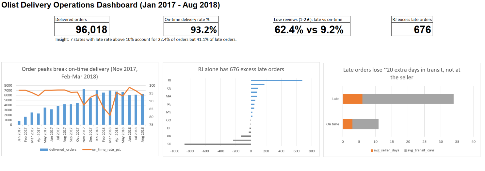

# E-commerce Delivery Operations Analysis (Olist)

Analysis of ~96,000 delivered orders from Olist, a Brazilian e-commerce marketplace, to find where and why deliveries are late and what that costs in customer satisfaction.

**Tools:** SQL Server (CTEs, window functions, joins, views), Excel (XLOOKUP, SUMIFS, COUNTIFS, PivotTable, dashboard)
**Period:** January 2017 - August 2018
**Data:** [Brazilian E-Commerce Public Dataset by Olist](https://www.kaggle.com/datasets/olistbr/brazilian-ecommerce) (Kaggle)

## Key findings

1. **Late delivery destroys customer satisfaction.** 62.4% of late orders received a 1-2 star review, compared with 9.2% of on-time orders (6.8x higher). Average score: 2.27 vs 4.29.

2. **Order peaks break on-time delivery.** On-time rate is normally 95-97%. It fell to 87.6% in November 2017 (Black Friday, orders +63% month over month) and to 81.0% in March 2018, when 1 in 5 orders arrived late. Median delivery time rose from about 10 days to 13-14 days in the same period.

3. **Delays happen in transit, not at the seller.** Late orders take 6.0 days to reach the carrier (vs 3.0 for on-time orders) and 27.9 days in transit (vs 8.0). About 87% of the extra time is lost in the transit stage.

4. **Rio de Janeiro (RJ) is the biggest single problem.** RJ has a 12.2% late rate, versus 4.6% in MG and 4.1% in PR, although shipping costs per order are almost the same (23.96 vs 23.48 and 23.49). Distance does not explain the gap. Compared with the average late rate, RJ has 676 excess late orders, more than all other underperforming states combined (616).

5. **Late deliveries are concentrated.** 7 states with a late rate above 10% account for 22.4% of orders but 41.1% of late orders. The North and Northeast also pay the most for shipping: in MA, freight equals 26% of the product value.

6. **Most of the worst sellers are slow to ship.** Among sellers with 30+ orders, 6 of the 10 with the highest late rate take 7-15 days to hand orders to the carrier, versus about 3 days for a typical on-time order.

## Recommendations

1. **Review last-mile delivery in RJ first.** Fixing RJ alone would remove more excess late orders than fixing every other underperforming state. Compare carrier performance in RJ with MG and PR, which have similar costs.
2. **Plan carrier capacity before peak periods.** Add capacity ahead of Black Friday and the February-March period, when on-time delivery dropped to 81-88%.
3. **Set a handover SLA for sellers** (for example, 3 days to carrier) and track it in a weekly report, starting with the slowest sellers.
4. **Set realistic delivery estimates for high-risk states** (MA, CE, BA, RJ). A late order is far more likely to get a 1-2 star review than a slower but accurately promised one.

## Approach

| File | Question |
|---|---|
| `sql/00_data_quality_checks.sql` | Status distribution, missing and illogical dates, duplicates |
| `sql/01_create_view.sql` | Clean view of delivered orders used by every query |
| `sql/02_monthly_orders.sql` | Q1: How did delivered orders change month over month? |
| `sql/03_delivery_time.sql` | Q2: How did average and median delivery time change? |
| `sql/04_on_time_rate.sql` | Q3: What share of orders arrived on time each month? |
| `sql/05_late_by_state.sql` | Q4: Which states have the highest late rate? |
| `sql/06_freight_per_order.sql` | Q5: What is the freight cost per order by state? |
| `sql/07_delivery_stages.sql` | Q6: Where do late orders lose time: seller or transit? |
| `sql/08_late_vs_reviews.sql` | Q7: How does lateness affect review scores? |
| `sql/09_late_by_seller.sql` | Q8: Which sellers have the highest late rate? |

`excel/delivery_dashboard.xlsx` contains the query results, XLOOKUP/SUMIFS calculations, a quarterly PivotTable and the dashboard.

## Data quality notes

- About 200 delivered orders (0.2%) had missing dates or impossible sequences (for example, delivered to the customer before being handed to the carrier). They were excluded in a single view so every query uses the same definition.
- `order_items` and `order_reviews` can have several rows per order. Joining them directly would count orders more than once, so each was aggregated to one row per order (or per order and seller) before joining. In the seller analysis, skipping this step put a seller with a 50% late rate at the top of the list; after the fix, that seller dropped below the 30-order threshold.
- Medians are reported alongside averages because delivery time is right-skewed: a few very slow orders pull the average up.
- An order counts as late only if it arrived after the estimated delivery date (compared by date, not time).

## Limitations

- Freight value is the shipping fee paid by the customer, used as a proxy for delivery cost. Courier-level cost and working hours are not available.
- Only delivered orders are analysed. In the last months of the dataset, slow orders may not have been delivered yet, so recent delivery times may look better than they were.
- Months with incomplete data (before January 2017 and after August 2018) are excluded.
